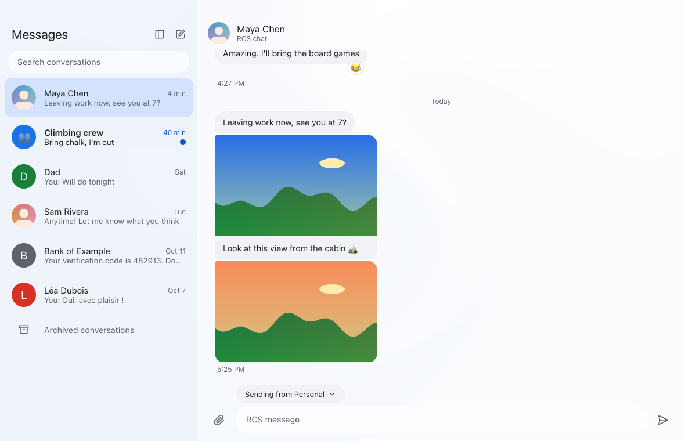

# GoMessages

Google Messages for Mac, Windows, and Linux.
A real desktop app, fast and keyboard-friendly.

- Your conversations, photos, reactions, and replies, in a desktop window.
- Jump to anyone with `Cmd+K`. Every action has a shortcut.
- Eight themes, light and dark, with optional see-through windows.
- Notifications with or without a preview.
- No telemetry. Messages stay between your computer, Google, and your phone.

## Install

1. Download your build from the [latest release](https://github.com/jbouhier/GoMessages/releases/latest).
   - **Mac:** open the `.dmg` and drag GoMessages to Applications.
   - **Windows:** unzip and run `GoMessages.exe`.
   - **Linux:** unpack and run `gomessages`.
2. Choose **Sign in with Google**.
3. Tap the matching emoji on your phone. That's it, it stays signed in.

Your phone needs Google Messages and an internet connection.

## Shortcuts

| Action                 | Shortcut          |
| ---------------------- | ----------------- |
| Switch conversation    | `Cmd+K`           |
| New chat               | `Cmd+N`           |
| Search                 | `Cmd+F`           |
| All shortcuts          | `Cmd+/`           |
| Settings               | `Cmd+,`           |
| Text size              | `Cmd+=` / `Cmd+-` |

On Windows and Linux, use `Ctrl` instead of `Cmd`.

## Help

* **Signed out after a few weeks**: Google ends pairings it doesn't see used. Pair again.
* **Start fresh**: Settings → Account → Unpair, then sign in again.
* **Mac says the app can't be opened**: right-click it, choose Open, then Open.

More in the [user guide](https://jbouhier.github.io/GoMessages/) and
[what's new](CHANGELOG.md).

---

Unofficial project. Not affiliated with Google.
Licensed under the [AGPL-3.0](LICENSE). Built on
[libgm](https://github.com/mautrix/gmessages).

[Developer documentation](docs/README.md)
