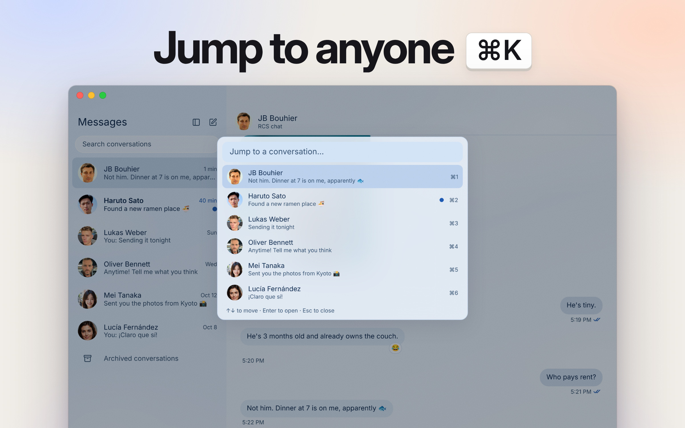
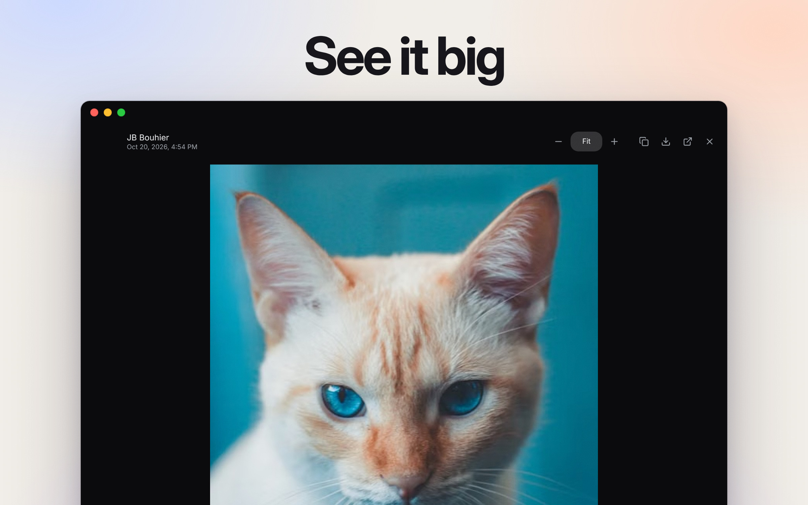
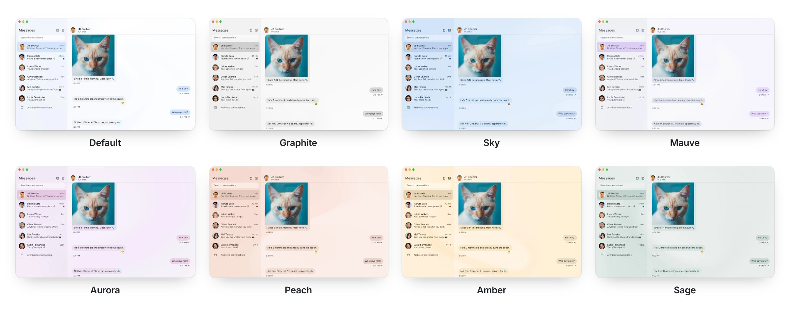

  

<h1 align="center">GoMessages</h1>

  <b>Your texts, on your desktop.</b> 
  Google Messages for Mac, Windows, and Linux.

  <a href="https://github.com/jbouhier/GoMessages/releases/latest/download/GoMessages-macos-aarch64.dmg"><b>Download for Mac</b></a>
  &nbsp;·&nbsp;
  <a href="https://github.com/jbouhier/GoMessages/releases/latest/download/GoMessages-windows-x86_64.zip"><b>Windows</b></a>
  &nbsp;·&nbsp;
  <a href="https://github.com/jbouhier/GoMessages/releases/latest/download/GoMessages-linux-x86_64.tar.gz"><b>Linux</b></a>
  &nbsp;·&nbsp;
  <a href="https://jbouhier.github.io/GoMessages/">Website</a>

  
  
  

https://github.com/user-attachments/assets/518209fe-05ce-4c04-a8e7-4f19beb05b79

## Tour

  
  
  
  

## Themes

<picture>
  <source media="(prefers-color-scheme: dark)" srcset="./site/public/product/readme/themes-dark.jpg">
  
</picture>

Each theme has a light and a dark side. [Try them on the website](https://jbouhier.github.io/GoMessages/themes/).

## Install

1. Download the file for your computer (links at the top).
   - **Mac:** open the `.dmg` and drag GoMessages to Applications.
   - **Windows:** unzip and run `GoMessages.exe`.
   - **Linux:** unpack and run `gomessages`.
2. Choose **Sign in with Google**.
3. Tap the matching emoji on your phone. It stays signed in.

Your phone needs Google Messages and an internet connection.

## Help

- **Mac says the app can't be opened:** right-click it, choose Open, then Open.
- **Messages are not loading:** unlock your phone so it can sync.
- **Signed out after a few weeks:** Google ends pairings it doesn't see used. Pair again.
- **Start fresh:** Settings → Account → Unpair, then sign in again.

More in the [user guide](https://jbouhier.github.io/GoMessages/) and [what's new](CHANGELOG.md).

---

Unofficial project. Not affiliated with Google.
Licensed under the [AGPL-3.0](LICENSE). Built on
[libgm](https://github.com/mautrix/gmessages).
Demo portraits are AI-generated ([faker-js](https://github.com/faker-js/assets-person-portrait), CC0), except JB's.
Cat photo by [Lucas Pezeta](https://www.pexels.com/photo/attentive-cat-with-red-and-white-fur-6318997/) on Pexels.
Kyoto photos from [Unsplash](https://unsplash.com/license).

[Developer documentation](docs/README.md)
